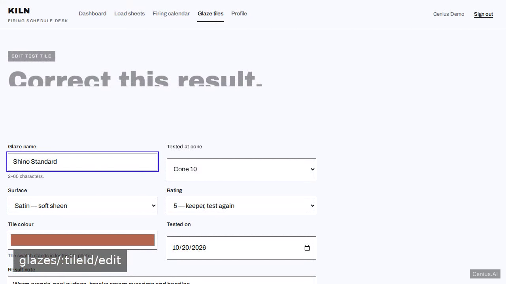
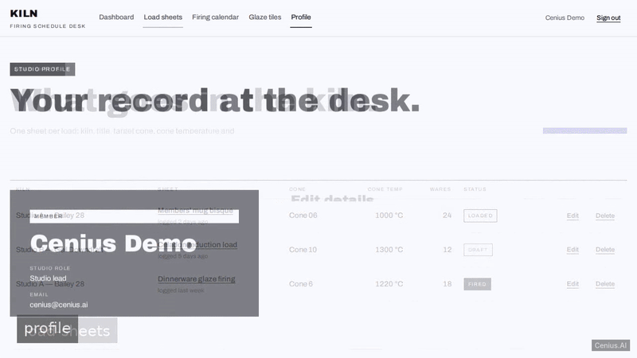
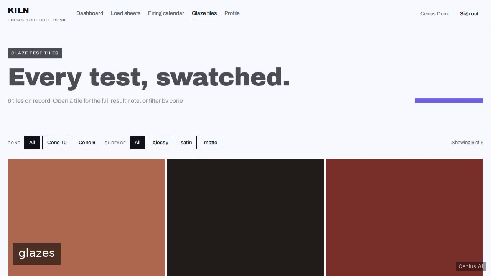
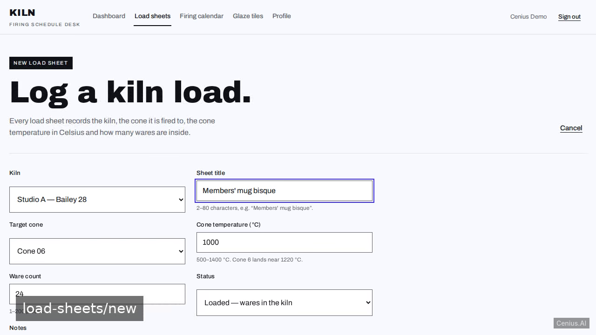

# Kiln Firing Schedule Desk — complete Vite appointment scheduling system example app

This repository contains the complete source for **Kiln Firing Schedule Desk**, an open-source appointment scheduling system built with Vite. A two-service studio app for a ceramics studio: a FastAPI backend (bcrypt password hashing, PyJWT session cookie, SQLite persistence, idempotent seed data) and a Vite React frontend whose dev server proxies /api to th…. Everything Kiln Firing Schedule Desk needs to run is here — code, seed data, install scripts. Apache-2.0-licensed — use Kiln Firing Schedule Desk commercially, self-host it, or [remix Kiln Firing Schedule Desk on cenius.ai](https://cenius.ai/marketplace/p/kiln-firing-schedule-desk?ref=gh&utm_campaign=kiln-firing-schedule-desk-vite) to make it yours.


[](LICENSE)  [](https://cenius.ai)

[](https://cenius.ai/marketplace/p/kiln-firing-schedule-desk?ref=gh&utm_campaign=kiln-firing-schedule-desk-vite)

> **▶ [Open & edit in cenius.ai](https://cenius.ai/marketplace/p/kiln-firing-schedule-desk?ref=gh&utm_campaign=kiln-firing-schedule-desk-vite)** — one click to an editable workspace: describe changes in plain English, get an instant preview, one-click deploy and host. Modifications made on the platform come with full rebrand & relicense rights.

_Local clone? See [Quick start](#quick-start) below. cenius.ai is the zero-setup path._

## Demo





▶ **[Full demo walkthrough](https://cenius.ai/marketplace/p/kiln-firing-schedule-desk?ref=gh&utm_campaign=kiln-firing-schedule-desk-vite)** — watch it on the project page · [download MP4](.github/media/demo.mp4)

## Screenshots

  

## Quick start

```bash
./install.sh   # installs dependencies + seeds demo data
```

See [`INSTALL.md`](INSTALL.md) for full setup and usage instructions.

## Architecture

The repository contains 109 files of Vite source, organised under `backend/`, `frontend/`. `install.sh` provisions dependencies and seeds demo data so the app starts with something real to explore. Full setup details: [`INSTALL.md`](INSTALL.md).

## Features

- Email and password sign-in with a seeded demo account
- Kiln load sheets with cone temperature and ware count
- Firing calendar per kiln with cooldown windows
- Glaze test tile results gallery
- Studio member profile page
- Studio dashboard overview

## Usage guide

### Overview

This is **Kiln Firing Schedule Desk** — an HTTP API + web UI. This document covers the surface area you can use, with copy-pasteable examples for each entry point. For setup, see `INSTALL.md`.

### Quickstart

After completing the install steps in `INSTALL.md`:

```bash
## start the dev server (see INSTALL.md step 6)
## in another terminal:
curl http://localhost:8000/
```

### Endpoints

Every endpoint below was extracted from the source by the route scanner (Next.js / FastAPI / Flask / Django / Express).

_Full guide: [`USAGE.md`](USAGE.md)_

## FAQ

### How do I run Kiln Firing Schedule Desk on my own server?

Grab the repo and run `./install.sh` — it handles packages and seed data in one go. After that, [`INSTALL.md`](INSTALL.md) walks you through starting the server. No external accounts required.

### Can I remove the Kiln Firing Schedule Desk name and use my own?

Yes — and the easiest way is [remixing it on cenius.ai](https://cenius.ai/marketplace/p/kiln-firing-schedule-desk?ref=gh&utm_campaign=kiln-firing-schedule-desk-vite): modifications made on the platform come with full rebrand and relicense rights over your derivative.

### Can I change Kiln Firing Schedule Desk without writing code?

Describe what you want changed on [cenius.ai](https://cenius.ai/marketplace/p/kiln-firing-schedule-desk?ref=gh&utm_campaign=kiln-firing-schedule-desk-vite) — no code editing needed; the platform produces a fresh build you can download and deploy.

### How is Kiln Firing Schedule Desk built technically?

The app is built with Vite. What you see in this repo is the full production source, demo data included. Highlights include studio member profile page.

### Can I build a business on Kiln Firing Schedule Desk?

It is. Apache-2.0 licensing means you can build a product on it, sell it, or use it inside a company with no fees. Details: [LICENSE](LICENSE).

## License & rebranding

Released under the [Apache License 2.0](LICENSE) (© 2026 Cenius AI) — free for personal and commercial use. The Cenius name/logo are trademarks (see NOTICE).

**Need a customized version?** [Remix this app on cenius.ai](https://cenius.ai/marketplace/p/kiln-firing-schedule-desk?ref=gh&utm_campaign=kiln-firing-schedule-desk-vite) — modifications made on the platform come with **full rebrand & relicense rights** over your derivative.

## Built with cenius.ai

This entire application — code, design, seeded demo data — was generated on **[cenius.ai](https://cenius.ai)** from a plain-English description.

- 🚀 [Build your own app on cenius.ai](https://cenius.ai)
- 🎛️ [Remix Kiln Firing Schedule Desk on the marketplace](https://cenius.ai/marketplace/p/kiln-firing-schedule-desk?ref=gh&utm_campaign=kiln-firing-schedule-desk-vite) — open it in a workspace, prompt for changes, and ship your own version.

More open-source apps: [the Cenius-ai catalog](https://github.com/Cenius-ai) · [showcase index](https://github.com/Cenius-ai/showcase)
